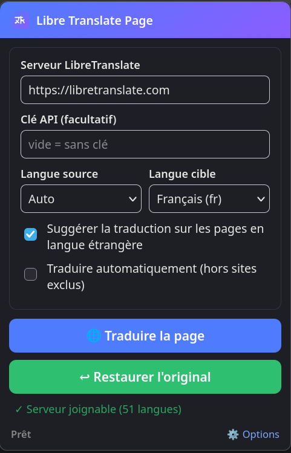
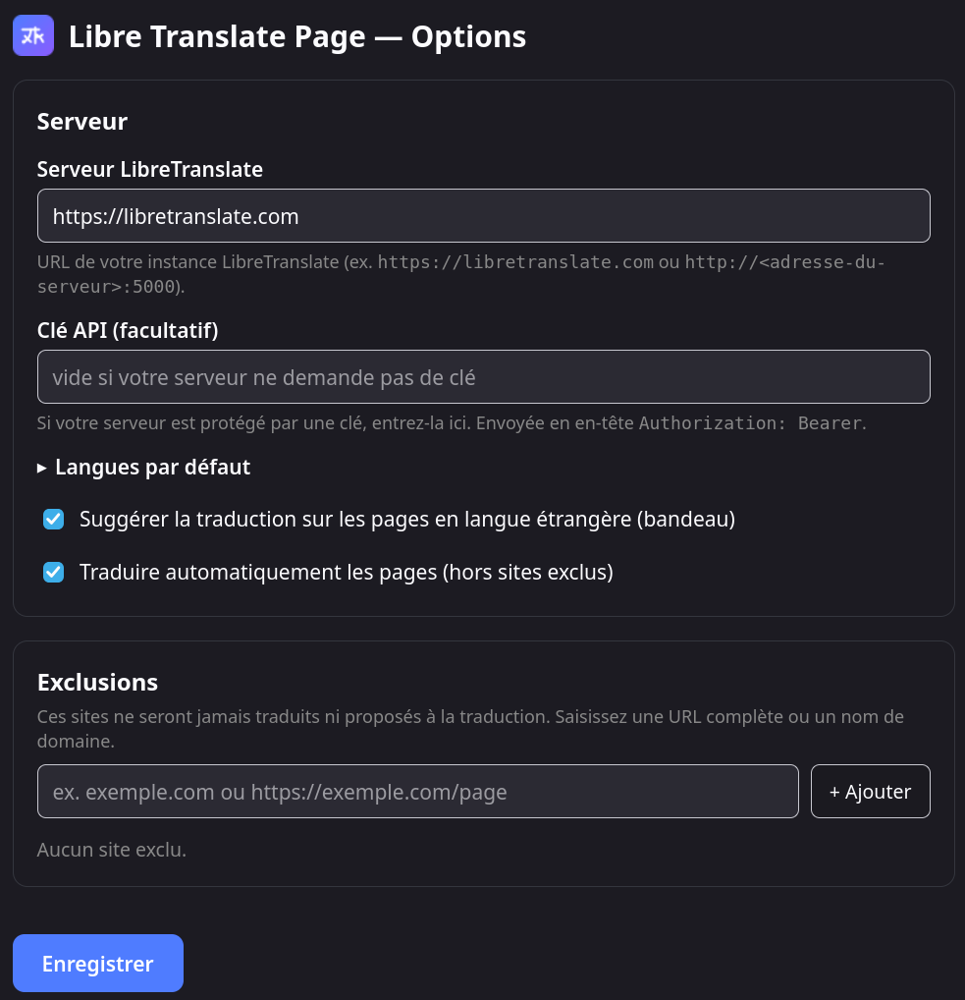
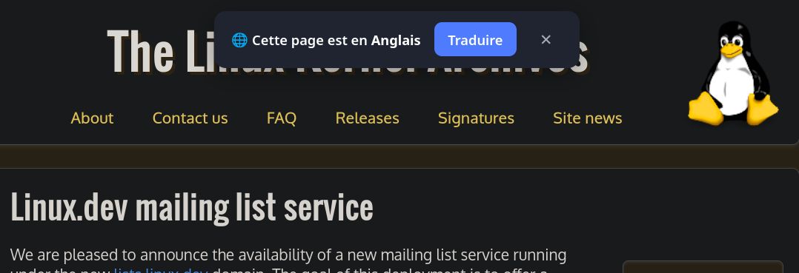

# Libre Translate Page

Extension **Firefox** qui traduit une page web entière en utilisant **votre propre
serveur [LibreTranslate](https://github.com/LibreTranslate/LibreTranslate)** —
sans Google, sans clé API externe, sans tracking.

Inspirée de [TWP – Translate Web Pages](https://github.com/FilipePS/Traduzir-paginas-web)
(service Google remplacé par LibreTranslate).

## Captures d'écran

**Popup** — serveur, clé API, langues, options et boutons Traduire / Restaurer :



**Page Options** — serveur, langues par défaut, traduction automatique, exclusions :



**Bandeau de suggestion** — affiché en haut de page quand la langue est étrangère :



## Fonctionnalités

- 🌐 **Traduction de la page complète** : tous les nœuds de texte sont traduits
  par lots (25 textes par requête) vers votre serveur LibreTranslate.
- 🔤 **Détection automatique** de la langue source (route `/detect`), ou
  langue source fixe.
- 💬 **Bandeau de suggestion** : quand une page est dans une langue étrangère
  (différente de la langue cible), un bandeau propose de la traduire en un clic.
  Désactivable via le ✕ du bandeau ou le toggle dans le popup / les options.
- ↩︎ **Restauration de l'original** en un clic (recharge la page).
- ⚡ **Indicateur de progression** : le badge de l'icône affiche le pourcentage
  de traduction en cours ; une **barre de progression** s'affiche dans le
  popup de l'icône et dans le bandeau, puis disparaît 3 s après 100 %.
- 🖱️ **Traduire une sélection** : sélectionnez du texte, clic droit →
  « Traduire la sélection » ; la traduction s'affiche dans une bulle près du
  texte, sans quitter la page.
- 🤖 **Traduction automatique** (option) : les pages en langue étrangère sont
  traduites sans clic, hors sites exclus.
- 🚫 **Exclusion de sites** (mode traduction automatique) : exclure le site de
  l'onglet actif via le bouton 🚫 du popup, ou saisir une URL dans les options.
  La liste est gérée (avec corbeille) dans la page Options.
- ⚙️ **Serveur configurable** : URL + clé API (optionnelle), langues par défaut.
- 🌗 Mode clair/sombre automatique dans le popup.

## Instance par défaut et auto-hébergement

Par défaut, l'extension pointe vers l'instance publique **https://libretranslate.com**.
Elle est utilisable immédiatement, **mais cette instance impose des limitations de
requêtes par minute** (et peut être lente ou saturée aux heures de pointe).

Pour un usage régulier — en particulier la **traduction automatique** ou la
**traduction de pages entières**, qui génèrent beaucoup de requêtes — il est
fortement recommandé d'**héberger sa propre instance LibreTranslate** :

```bash
docker run -p 5000:5000 libretranslate/libretranslate:latest
```

Ou une installation locale : `pip install libretranslate` puis `libretranslate-server`.

Renseignez ensuite l'URL de votre instance (et sa clé API si elle en demande une)
dans le popup ou la page **Options**.

## Installation du fichier `.xpi` (Firefox)

1. Télécharger le fichier :
   `https://github.com/Julien684/libre-translate-page/releases/download/v1.3.5/libre-translate-page-1.3.5.xpi`
2. **Sur Firefox Release**, les extensions non signées par Mozilla sont refusées.
   Pour autoriser l'installation de ce `.xpi` :
   - Ouvrir `about:config` et accepter l'avertissement.
   - Chercher `xpinstall.signatures.required` et le passer à **`false`**.
   - (Optionnel, Firefox ≥ 141 : chercher `xpinstall.enabled` et le laisser à `true`.)
3. Ouvrir `about:addons` → ⚙️ (en haut à droite) →
   **« Charger un module complémentaire depuis un fichier… »** → sélectionner le `.xpi`.
4. L'extension est installée de façon permanente (elle survit aux redémarrages).

> Sur **Firefox Nightly / Developer Edition** ou en **Mode développement**
> (`about:debugging#/runtime/this-firefox`), l'étape `about:config` n'est pas
> nécessaire : les extensions non signées y sont autorisées par défaut.

> ⚠️ `xpinstall.signatures.required = false` autorise l'installation de **toute**
> extension non signée — ne l'activez que si vous savez pourquoi, puis rétablissez
> la valeur `true` une fois l'extension installée.

## Installation (développement, sans `.xpi`)

1. Ouvrir Firefox → `about:debugging#/runtime/this-firefox`
2. « Charger un module complémentaire temporaire… »
3. Sélectionner le fichier `manifest.json` de ce dépôt.

L'extension reste active jusqu'à redémarrage de Firefox (mode temporaire).

## Utilisation

1. Cliquer sur l'icône de l'extension.
2. Saisir l'URL de votre serveur LibreTranslate (défaut : `https://libretranslate.com`).
3. Choisir les langues (source : *Auto* par défaut, cible : *fr*).
4. Cliquer **🌐 Traduire la page**.
5. **↩︎ Restaurer l'original** recharge la page non traduite.

> Note : si le popup signale « Serveur injoignable », vérifiez que le serveur est
> accessible depuis Firefox (CORS activé côté serveur si besoin, ou proxifiez-le).

## Structure

```
manifest.json          # manifest MV2 (Firefox)
background.js          # appels API LibreTranslate, injection des scripts, exclusions
lib/exclusions.js      # logique pure : matching d'exclusion de sites
lib/detect.js          # logique pure : parse de /detect
lib/batch.js           # logique pure : alignement des lots
lib/lt.js              # logique pure : construction de la requête
lib/progress.js        # logique pure : machine à états de progression
content/translate.js   # parcourt la page, traduit par lots
content/restore.js     # restaure l'original (recharge)
content/banner.js      # bandeau de suggestion + bouton d'exclusion 🚫
popup/                 # popup : serveur, langues, barre de progression, traduire/restaurer
options/               # page d'options : langue, auto-traduction, exclusions
icons/                 # icônes (SVG sources + PNG)
test/                  # tests unitaires / non-régression (node test/run.js)
```

## API LibreTranslate utilisée

| Route        | Usage                              |
|--------------|------------------------------------|
| `POST /translate` | traduction d'un lot de textes |
| `POST /detect`   | détection de la langue source   |
| `GET  /languages`| liste des langues disponibles     |

## Limites connues

- Les textes dans `<code>`, `<pre>`, `<textarea>`, `<svg>` etc. ne sont pas traduits.
- La restauration repose sur un rechargement de la page (les contenus dynamiques
  générés par JavaScript sont rechargés tels quels).
- Les pages protégées (`about:`, `addons.mozilla.org`, PDF…) ne sont pas injectables.

## Licence

[GPL v3](LICENSE)
